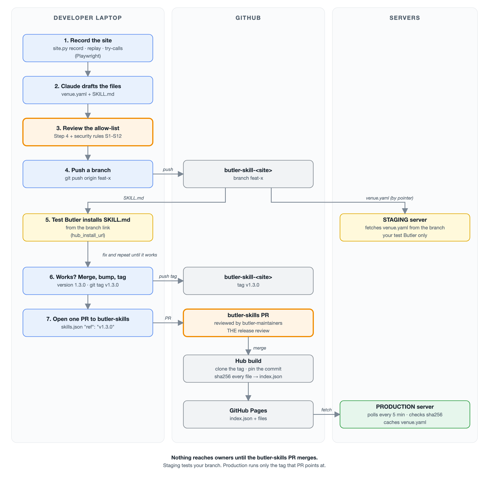
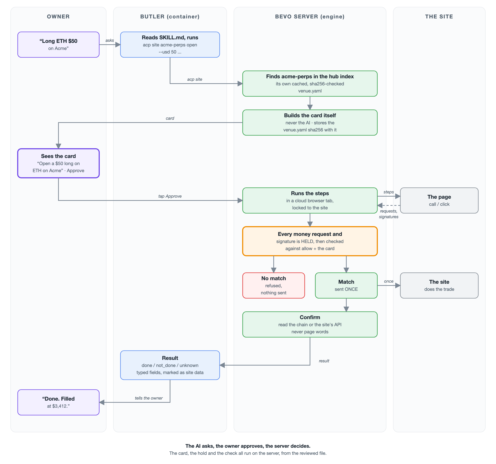

# How to add a website to Butler

A step-by-step guide for Bevo developers. Only internal developers build venue skills for now.

The one-page version is [QUICKSTART.md](QUICKSTART.md).

Status, 2026-10-28: **this is a proposal.** It follows Ariessa's design, "Butler on any
website": one shared engine, four safety stops, and one venue description per popular site.
Part of it exists on `bevo-server` `dev` today, and part of it must be built first. Part 12
lists exactly what exists and what does not.

---

## Part 1. The idea in one example

Say someone asks: "Can Butler open a $50 long on ETH on Acme Perps?"
(Acme Perps is a made-up site used in this guide.)

**Today**, a new site is a TypeScript actions file inside `bevo-server`, written and tested
by a developer. Variational is about 2,400 lines that only know Omni. Every new site waits
on developer time.

**With this design**, there are three levels. A site moves up when enough users want it.

```
Level 0  No venue description     Works from day one. Slow. EVERY write waits for the
                                  owner's approval. The AI works the site out each time.
Level 1  Saved steps               Butler remembers the steps that worked. Faster.
                                  Steps that move money still need a developer review
                                  before they replay without the AI.
Level 2  Venue description         One reviewed file, about 200 lines, no code.
                                  An action takes seconds after the card tap.
```

This guide is mostly about Level 2: how to write a venue description.

A venue description is **one file** that lives in the site's own skill repo, next to
`SKILL.md`. **No per-site code or file goes into `bevo-server`.**

```
butler-skill-acme-perps/          the site's skill repo (public; Bevo developers write it)
  SKILL.md                        when to use Acme Perps, and what to tell the owner
  venue.yaml                      the allow-list + the steps for each action
  venue.test.yaml                 the recorded walkthrough, used as the test
  BENCHMARK.md   (optional)       the real-money runs (Step 5)

butler-skills/                    the existing registry repo (the app's Skills list)
  skills.json                     lists every skill, as today: repo + ref. The hub
                                    build pins the commit and hashes every file.
  scripts/site.py                 new: the developer tools (record, replay, test, ...)
```

You write no server code. A site goes live the way every skill does today: one line in
`butler-skills/skills.json`, reviewed by the maintainers (Part 9).

**The one rule that makes this safe:**

> The steps can be wrong. The money cannot be wrong.

- If a step is wrong, a check fails and the run stops. Nothing was sent.
- Every request or signature that could move money is held by the engine. It goes out
  only if the venue file's allow-list names it AND it matches the card the owner approved.
  It goes out once, never twice.

So a wrong or tampered venue file stops. It does not move money.

### The whole flow, in two pictures

**Picture 1. A developer builds and releases a venue skill.**



**Picture 2. An owner uses it in production.**



The images are in `images/`, next to this file. Both are drawn by `images/flow_svg.py`. To
change the flow, edit that script, run `python3 images/flow_svg.py images`, then turn each
`.svg` into a `.png` (open it in Chrome and take a screenshot, or use Chrome headless).

What each picture shows:
- **Picture 1:** nothing reaches owners until the `butler-skills` PR merges. Staging tests a
  branch; production runs only the tag that PR points at.
- **Picture 2:** the AI asks, the owner approves, and the server decides. The card, the hold
  and the check all happen on the server, from the reviewed file, never from what Butler or
  the page says.

---

## Part 2. The four safety stops

These run on every site, at every level. They are the engine's, not the site's.

**1. The signing check.** Before anything is signed, our server works out what the signature
really does, then checks it against the card. Example: a USDC Permit is signed only when the
spender is the site's known contract and the amount is at most the card's amount.

> **Note: on a site with a venue file (Level 2), every contract must be whitelisted.**
> The server signs only for contracts listed in the venue's allow-list (`venue.yaml` →
> `allow.signatures` and `allow.sources`). A contract that is not listed is refused, even
> if the card looks right.
>
> **On a site with no venue file (Levels 0 and 1), there is no whitelist.** A contract
> that nobody listed is not refused. Instead, **each signature gets its own card**:
>
> ```
> Level 2 (whitelisted)     one card for the action → the server signs every listed
>                           call that matches it, with no more taps
> Level 0/1 (not listed)    one card PER signature → the owner taps each one
> ```
>
> On that per-signature card, the server (never the AI) shows what it can prove:
> - the decoded call, when it is a known shape: ERC-20 `approve`, `transfer`, Permit,
>   Permit2. Example: "Allow 0x1234…abcd to spend up to 50 USDC".
> - a simulation of the transaction: what leaves and what enters the wallet. Example:
>   "−50 USDC, +0.0147 ETH".
> - a clear warning: "This contract is not verified by Bevo."
>
> The "never allowed" rules (Part 7) still apply at every level: no unlimited approve, no
> `setApprovalForAll` to an unknown address, no sign-in for another site. A call the
> server can neither decode nor simulate is refused.
>
> So a whitelist is not what makes a site work. It is what makes it **fast**: one tap
> instead of one tap per signature.
>
> On a Level 2 site, the whitelist covers every address a signature or transaction can
> touch:
>
> ```
> verifyingContract   the contract in the EIP-712 domain     e.g. USDC on Base
> to                  the contract a transaction is sent to   e.g. the site's router
> spender / operator  who gets an allowance                   e.g. the site's vault
> ```
>
> Each address needs a source link in `allow.sources`: the site's official docs or a block
> explorer, never only the page (Step 4). A site that adds a new contract needs a new
> venue version, with a new review and a new hub build, before Butler can sign for it.

**2. The money hold.** Anything the page sends that could move money waits until the owner
approves. Example: on Variational the login alone can trade, so a `POST /api/orders` from
the page is held, checked against the card, and sent once.
- With a venue description: only the calls its allow-list marks as money are held and
  checked. A call not on the list never goes out.
- With no venue description: **every write** is held. That is every request that is not a
  plain read, every websocket message the page sends, and any signature that gives the page
  a key of its own (a "session key" or "agent wallet").

**3. The login handoff.** On a site with an email or password login, the owner logs in
themselves, on a live view of the cloud browser. The login is never recorded. Butler never
sees the password, and the login tokens never leave the browser. A wallet sign-in
(EIP-4361) needs no handoff: the server signs it with Butler's wallet, under the signing
check.

**4. The result check.** The result is checked on chain, or with a fresh read of the site's
API. Never from page words. Never on the AI's word.

Two more rules hold everywhere:

- **The approval card is written by our server**, from the request it holds and the
  owner's arguments. Never by the AI. A hostile page cannot talk the AI into describing a
  harmful action as harmless.
- **Butler has no browser of its own.** Every page it opens runs inside the engine. Butler
  never gets the wallet key or the owner's saved logins.

---

## Part 3. Who writes what

```
ONCE, BY BEVO (bevo-server)          PER SITE (butler-skill-<site>)   PER VERSION (butler-skills)
---------------------------          ------------------------------   -----------------------------
The engine: browser in the           SKILL.md                         the skills.json line,
  owner's country, tab locked        venue.yaml                         reviewed by the maintainers;
  to one site, runs the steps          the allow-list                 the hub pins commit + sha256
The injected wallet                    the steps for each action
The 4 safety stops                   venue.test.yaml
The card, built from the file        BENCHMARK.md (optional)
The hub-index check (commit + sha256)
`acp site <name> <action>`

ONCE, BY BEVO (butler-skills)
-----------------------------
scripts/site.py: the developer tools
build_index.py publishes venue.yaml too
```

The site author never touches the browser session, the wallet key, or the card code.
A venue file never holds its own code.

`bevo-server` changes only when the **engine** changes, never for a new site. Example: if a
site needs a step type the engine does not have yet, the engine gains it once, and every
site can use it. That is rare, and it is reviewed like any server change.

---

## Part 4. Does my site need a venue description? (check this first, 5 minutes)

First: **is it worth it?** A site with no venue description already works at Level 0. Write
one only when many owners want the site, or it is used often enough that speed matters.

Then answer these 6 questions. Open the site in a normal browser and look.

| # | Question | Good answer | If not |
|---|---|---|---|
| 1 | Are we allowed to automate it? (terms of service) | Yes | Ask Legal. Stop until yes. |
| 2 | How does money move: a wallet popup, or the login alone? | Either is fine | Write it down. It sets `moneyBy`. |
| 3 | Does a trade go over a websocket message? | No | Wait for the socket hold (Part 12). |
| 4 | Which chain? Is it in `bevo-server/server/chains.ts`? | Yes | Add the chain first. |
| 5 | Is the site blocked in some countries? | We know the list | Ask Legal. |
| 6 | Does it need KYC, a whitelist, or an invite code? | No, or we have one | Ask the site team. |

**Question 2 matters most.** It decides which safety stop guards the money:

```
moneyBy: wallet     Every money move asks the wallet to sign. The signing check guards it.
                    Example: Polymarket.
moneyBy: session    The logged-in session alone can trade, no wallet popup.
                    The money hold guards it. Example: Variational.
```

Both kinds can have a venue description. A session site just needs every money call listed
in the allow-list, because nothing else will stop it.

**Question 3:** today the money hold sees HTTP requests but not a socket's messages
(`docs/site-command.md` § The request check). A site that trades over its socket cannot be
held yet.

Example answers for Acme Perps:

```
1. Yes. Terms allow API and bot use.
2. Session. A logged-in POST /api/orders trades with no popup.
   Deposits ask the wallet for a USDC Permit.
3. No. Orders are HTTP. The socket only sends prices and fills.
4. Base (8453). In chains.ts.
5. Blocked in the US. We have the list.
6. No.
```

---

## Part 5. Step by step

Developers step in four times: **deciding** (Part 4), **recording the actions** (Step 1),
**reviewing** (Step 4), and the **real-money test** (Step 5). The AI drafts the files
(Step 2) and, once the engine exists, runs the tests (Step 3).

Each step says what you do. Steps 2 to 5 also say **what to paste into Claude Code**. Run
Claude Code in the `~/bevo` folder.

### Step 1. Record each action with Playwright

Every action is recorded as a **Playwright script**, on a **test account**, with a small
amount of real money ($1 to $5). Not "you click and Claude watches": the recording is a
script, so it can be replayed, compared and re-run when the site changes.

The recording gives three things:

- **Every network request the page sends**: method, path, body, and the answer. These become
  the `allow.calls` and `allow.reads` entries.
- **Every wallet call**: the method (`eth_signTypedData_v4`, `personal_sign`,
  `eth_sendTransaction`), the chain, the contract, and the decoded data. These become the
  `allow.signatures` entries.
- **Every click**, with the page at that moment. These become the `click` steps.

**Calls and clicks are both supported.** The rule: if the site's API works for a step, use
a `call`, because it is faster and a page redesign does not break it. Use a click only when
the API cannot do it. Example: Variational's order API is plain JSON, so it is a call.
Polymarket's page builds the order signature itself, so its bet is a click. Step 2 has the
checklist.

**Clicks are just as safe as calls.** The money is guarded by the money hold and the signing
check, not by the step type. When a click makes the page send a money request, or ask the
wallet to sign, that request is held and checked against the allow-list and the card, the
same as a `call`.

The flow, in three parts:

```
1a. Record     You click once in the Playwright Inspector (page.pause() → Record).
               Playwright writes the clicks as a script, one per action:
                 record/deposit.py, record/open.py, ...
               At the same time it saves the HAR, the trace and the wallet log.
1b. Replay     Run each script 2-3 more times with different amounts.
               No hand clicking. A path that only shows sometimes shows up here.
               Example: Polymarket withdraw used Relay or Offramp depending on
               the quote (fixes #1258, #1264); one run may show only one.
1c. Decide     For each step: can it be a `call`, or must it be a click?
               The script tries the call from inside the page (below) and
               compares the answer with what the click sent.
```

#### The recording tool: Playwright

Record with [Playwright](https://playwright.dev/), the way Ariessa captured Variational. It
runs on the developer's laptop only. The engine on `bevo-server` does not use it (the engine
drives the browser with its own DevTools code, `siteTab.ts`).

What Playwright gives you, and which file it feeds:

```
What Playwright records                   How                                Feeds
---------------------------------------   --------------------------------   -------------------
every request + answer (a HAR file)       record_har_path on the context     venue.yaml  allow.calls
                                                                             venue.test.yaml
every websocket message the page sends    page.on("websocket") → framesent   Part 4, question 3
every click, with the page at that        context.tracing (trace.zip,        venue.yaml  steps
  moment (screenshot + DOM snapshot)        open with trace.playwright.dev)  SKILL.md    what to say
every wallet call                         the recording wallet: an init      venue.yaml  allow.signatures
                                            script that logs every request
                                            (Playwright has no wallet
                                            logging of its own)
```

**Playwright does clicks, API calls, and raw CDP.** All three are built in, so one script
can try a step both ways while you record:

```python
# 1. Click. Playwright waits until the button is visible, enabled and stable first.
#    (That wait is the bug behind Polymarket withdraw fixes #1254 and #1255.)
page.get_by_role("button", name="Withdraw").click()

# 2. Call the site's API from inside the page, with its login cookies.
r = page.evaluate('fetch("/api/orders", {method: "POST", body: "..."}).then(r => r.json())')
# or: page.request.post(url, data=...)   (shares the context's cookies)

# 3. Raw CDP, for anything Playwright does not wrap.
cdp = page.context.new_cdp_session(page)
cdp.send("Fetch.enable", {"patterns": [{"urlPattern": "*"}]})

# It can also attach to a cloud browser (e.g. Browserbase) over CDP:
browser = playwright.chromium.connect_over_cdp(browserbase_connect_url)
```

Use it to answer one question per step: **`call` or click?** Try both during the recording.
If the call passes every replay, use the call: it is faster. Keep the click only when the
call cannot work, for example when it needs a token or signature the page makes itself.
Step 2 has the full checklist.

Websockets: `page.route_web_socket` (Playwright 1.48+) can see and stop the messages the page
sends. Use it to answer Part 4, question 3 ("does a trade go over a websocket?").

**Playwright is for recording only, for now.** The engine on `bevo-server` keeps its own
CDP code (`siteTab.ts`, 885 lines), because the money hold and the signing check are built
on it. Moving the engine to Playwright is a separate decision (Part 13).

The trace is the big win for fewer errors. For every step it shows what the page looked
like, which request went out, and what came back. So the AI drafts `venue.yaml` and
`SKILL.md` from what really happened, not from a guess. And the reviewer can open the
same trace and check each allow-list line against it.

**Never commit the raw HAR or trace.** They hold cookies, login tokens and session ids. A
scrub step removes `Cookie`, `Set-Cookie` and `Authorization` headers, token-like fields
and the wallet address (→ `0xOWNER`) before anything becomes `venue.test.yaml`. Keep the
raw files in the scratchpad and delete them after Step 4.

**Step 1 is a command, not a prompt.** Claude is not needed to record. The recorder is
`scripts/site.py` in the `butler-skills` repo: a Python script that uses Playwright. It is a
script file, not an installed program. The developer clones `butler-skills` once, next to
the site's skill repo:

```sh
# once per laptop
cd ~/bevo/butler-skills
pip install -r scripts/requirements-site.txt     # playwright, eth-account, pyyaml
playwright install chromium                      # or SITE_BROWSER_CHANNEL=chrome for your own Chrome
```

Then, from the `butler-skills` folder:

```sh
# 1a. Record: opens Chromium + the Playwright Inspector, one recording per action.
#     --repo is the skill repo folder; it is created if missing, and record/ goes there.
python3 scripts/site.py record acme-perps --origin https://app.acme.example \
    --repo ../butler-skill-acme-perps --actions login,deposit,open,close,withdraw,logout
#     Options: --chain-id 8453 (the wallet's first chain), --rpc <url> (without it the
#     wallet refuses every transaction: nothing is sent), --api-origin <url> (repeatable).

# 1b. Replay the money actions with other small amounts (--headless: no window)
python3 scripts/site.py replay acme-perps --actions deposit,open,withdraw --usd 2,3

# 1c. Send each recorded GET again as a call from inside the page; write
#     call-vs-click.json. A write is sent only when you name it (--write /api/x):
#     it can move money.
python3 scripts/site.py try-calls acme-perps

# Rebuild recording.json from raw/ (record and replay already do)
python3 scripts/site.py scrub acme-perps
```

During 1a, `record` opens the browser on the site and pauses. Press **Record** in the
Playwright Inspector, do the action once, then copy the Inspector's lines into
`record/<action>.py` (the recorder writes a stub with a `run(page, usd)` function) and
press **Resume**. The next action opens next.

Everything lands in one folder:

```
~/.cache/butler-site/acme-perps/     (or --work <dir>; never inside a repo)
  raw/                          NEVER committed, deleted after Step 4
    open-1.har                  every request + answer (cookies and tokens included)
    open-1.trace.zip            Playwright trace: actions, network, DOM, screenshots
    open-1.wallet.json          every wallet call, unscrubbed
    open-1.clicks.json          every click: role + name
    open-1.sockets.json         every websocket message the page sent
    open-1.meta.json            action, run, amount, start time
  profile/                      the browser profile: the login is kept between runs
  test-wallet.key               the TEST key (made on the first record; a few dollars only)
  site.json                     origin, repo, actions, chain: later commands need only <site>
  recording.json                the scrubbed timeline Claude reads (below)
  call-vs-click.json            per recorded GET: does the call answer like the click did?

../butler-skill-acme-perps/record/   in the skill repo, committed
  open.py                       one Playwright script per action: run(page, usd)
  withdraw.py
```

One file set per run: `open-1` is the recording, `open-2`, `open-3` the replays.
There is no `screens/` folder: open the trace (trace.playwright.dev) to see the page at
each step. `validate.py` refuses a skill repo holding any raw file, a key, `screens/`
or `recording.json` (security-rules.md S8).

#### How the Playwright data reaches Claude

Claude reads files from disk. Nothing is uploaded anywhere.

The raw files are too big and too private to hand over as they are. A HAR is often 20–50 MB
and is full of cookies, images and analytics. So the recorder's last step **merges and
scrubs** them into one small `recording.json`: one timeline per action, in order, with only
what the venue file needs.

```
raw HAR  ──┐
trace    ──┼──► merge by time ──► drop images, fonts, analytics, other origins
wallet   ──┘                  ──► scrub cookies, tokens, ids; my address → 0xOWNER
                              ──► recording.json   (usually under 200 KB)
```

What one action looks like in `recording.json`:

```json
{
  "action": "withdraw",
  "run": 1,
  "usd": "2",
  "timeline": [
    { "t": 0.0,  "click":   { "role": "button", "name": "Withdraw" }, "screen": "screens/withdraw-1-01.png" },
    { "t": 0.4,  "request": { "method": "GET",  "path": "/api/withdraw/quote?usd=2" },
                 "answer":  { "status": 200, "body": { "route": "relay", "fee": "0.04" } } },
    { "t": 2.1,  "click":   { "role": "button", "name": "Confirm" }, "screen": "screens/withdraw-1-02.png" },
    { "t": 2.3,  "wallet":  { "method": "eth_signTypedData_v4", "chainId": 137,
                              "verifyingContract": "0x…", "primaryType": "Order",
                              "message": { "maker": "0xOWNER", "amount": "2000000" } },
                 "answer":  "0x<signature>" },
    { "t": 2.9,  "request": { "method": "POST", "path": "/api/withdraw", "body": { "quote": "q-1" } },
                 "answer":  { "status": 200, "body": { "id": "w-1", "status": "pending" } } }
  ]
}
```

What Claude reads, for which job:

```
recording.json        Step 2: drafts allow.calls, allow.signatures, the steps, SKILL.md
record/*.py           Step 2: the exact click selectors Playwright found
call-vs-click.json    Step 2: call or click for each step
screens/*.png         Step 2: what the owner sees, for SKILL.md and the card text
                      (Claude reads images, so a screenshot settles "which button?")
trace.zip             only if something is unclear; Claude unzips it and reads its
                      action log (trace.trace, one JSON per line)
the raw HAR           never, unless you ask for one request by path
```

The reviewer in Step 4 can open the same `trace.zip` at trace.playwright.dev and check each
allow-list line against what really happened.

**The recording wallet.** Replays must not wait for a person to approve a popup. So the
recording uses a small wallet of our own, added by an init script, backed by a **test key
holding only a few dollars**. It logs every request and signs it. Never put a real owner's
key or a team wallet's key in it. The key stays in the scratchpad, never in the repo.
(To record a site that only accepts a known wallet extension, load Rabby with the same
test wallet instead, and approve the popups by hand during 1a.)

**Tips:**
- Name each recording after the action (`record/open.py`). The name tells the AI
  which requests belong to which action. You do not need to narrate in chat.
- Do the slow path once on purpose: a fresh account, a first-time approval. First-time
  popups (for example an "Enable Trading" window) only show once. They must be in the
  recording.
- Record any popup that appears by itself. Do not go looking for hidden setup screens.
- Note every request the page sends **by itself** (session refresh, balance reads, quotes).
  They must be in the allow-list as free, or the money hold will block them.
- Keep `record/*.py` in the skill repo. When the site changes, re-run them: the one
  that fails shows which step broke.

### Step 2. The AI drafts the venue file and its tests

#### Call or click: how to decide, step by step

**The rule: if the site's API works for a step, use the API (`call`).** Use a click only when
the API cannot do it. Reason: a call is faster. It is one request. A click has to wait for the
page to load, draw the button, and react, and only then does the same request go out.

Decide for **each step**, not for the whole site. Most sites mix them: reads by `call`, and
some actions by `click`.

Start from `call-vs-click.json` (Step 1c). It looks like this:

```json
{ "action": "open", "step": "place order", "request": "POST /api/orders",
  "click": { "passed": 3, "of": 3 },
  "call":  { "passed": 0, "of": 3, "why": "403: missing x-signature header" } }
```

Then ask these 5 questions, in order. The first "yes" decides. Questions 1-4 are the only
reasons to click. If none is a yes, it is a call.

```
1. Is there no API behind this screen at all?                         yes → click
   Example: a sign-up onboarding screen, a Cloudflare check.

2. Does the request carry something only the page's own code can      yes → click
   make? Look for a field you cannot explain, or one that changes
   every time in a way you cannot rebuild:
   - a signature or hash header (x-signature, x-nonce, an HMAC)
   - a captcha or Turnstile token
   - an encrypted or packed body
   Example: compare the same action in two replays. If a field
   differs and you cannot say where it came from, it is page-made.

3. Does the page build the WALLET signature from numbers it worked    yes → click
   out itself (an order salt, fee math, a route it picked)?
   Example: Polymarket's order. The page builds the EIP-712 order,
   so the bet step is a click, and the signing check still checks
   what the page asks the wallet to sign.

4. Did the call fail in any replay (call.passed < call.of)?           yes → click

5. Otherwise: the body is plain JSON, built only from the action's    → call
   arguments and earlier answers, and it passed every replay.
   Example: Variational. Omni's POST /api/orders is plain JSON,
   so the trade step is a call.
```

Why a call wins when both work:
- **Faster.** One request, with no waiting for the page to load and draw.
- **Breaks less.** A page redesign does not touch it. A click breaks when a button moves or
  its words change. That is where Polymarket withdraw's click fixes came from (#1253, #1254,
  #1255).

Why a click is still safe: the money is guarded by the money hold and the signing check,
not by the step type (Part 5, Step 1). A click on a money button is a `click-once`. A money
call is a `send-once`. Both are held and checked against the card.

Common mixes:

```
Reads (balances, positions, markets)   call      almost always plain GETs
Login                                  click     sign-in screens and wallet pickers
Money action, plain JSON API           send-once e.g. Variational trades
Money action, page-built signature     click-once e.g. Polymarket bets
Confirm the result                     call      a read of the chain or the API, never the page
```

Write the reason next to each click step in `venue.yaml`, so the reviewer can check it:

```yaml
      - click-once: "Buy {outcome}"   # why click: page builds the EIP-712 order (question 3)
```

#### The prompt

Paste this:

```
Step 2: from <scratchpad>/<site>/ (recording.json, record/*.py,
call-vs-click.json and screens/), add to the repo folder
~/bevo/butler-skill-<site>/ (Step 1 created it, with record/):
  - venue.yaml       (format in Part 7 of the guide)
  - venue.test.yaml  (the recording, with my wallet address replaced by 0xOWNER,
                      amounts kept, no cookies, tokens or account ids)
  - SKILL.md         (template in Part 7)

Rules:
  - every GET the steps use is in `allow.reads`; every other request in the recording
    is in `allow.calls`, marked free or money
  - every wallet call in the recording is in `allow.signatures`, and nothing else
  - every money action has a card, and every money field is tied to the card
  - every money action ends with a `confirm` that reads the chain or an API, never
    page words (a read action needs none)
  - steps use only the engine's step types (Part 7): call / goto / click / fill / wait /
    pick / check / send-once / click-once / confirm
  - choose call or click for each step with the 5 questions in Part 5, Step 2, using
    call-vs-click.json; write the reason as a comment on every click step
Then:
  - run python3 scripts/validate.py --standalone ../butler-skill-<site> from
    ~/bevo/butler-skills and fix every error in SKILL.md
  - show me, per action, each step as call or click with its reason
  - show me the allow-list and explain each entry in one plain line
```

### Step 3. Automatic tests (no money)

> **Not available yet.** This step needs four items from Part 12 first:
> 1 (the venue loader), 2 (the step types), 3 (the allow-list check) and 12 (dry-run mode).
>
> Why: only the engine knows how to run `venue.yaml`, and the engine is TypeScript inside
> `bevo-server`. So `site.py test` and `site.py dry-run` are thin clients: they send the
> venue file to a local `bevo-server` and print what it answers. Until those items exist,
> there is nothing for them to call.
>
> **Until then:** replay the Playwright scripts (`python3 scripts/site.py replay <site>`).
> That shows the site still works. It does **not** test `venue.yaml`, so Step 4's review and
> Step 5's real-money runs carry the full weight.

Once built, this is how it works. The engine replays each action against the recording,
and then against the real site with the wallet and the money hold in **"log, then refuse"**
mode. Every held request and every
signature is checked against the allow-list and a test card, logged as "would send" or
"would refuse", and then refused.

Paste this:

```
Step 3: from ~/bevo/butler-skills, run the venue tests for <site>
(python3 scripts/site.py test <site>), then a dry run of every action against the
local server (python3 scripts/site.py dry-run <site> <action> ...).
For each action show:
  - each step: passed / failed, with seconds
  - each held request and wallet call: would send / would refuse, and why
  - any request the page sent by itself that is not in the allow-list
Fix the steps until everything passes and every money call says "would send".
Do not change `allow` without asking me.
```

### Step 4. A developer reviews the allow-list (the safety step)

This is the only part where a mistake can cost money. Read **every line** of `allow`. For
each entry you should be able to say a sentence like:

> "For `open`, the page may send `POST /api/orders` once. The market and side must equal the
> card's. The size must be at most the card's size. The quote must be one the tab recorded."

Paste this:

```
Step 4: for each entry in `allow` of butler-skill-<site>/venue.yaml, tell me:
  - which actions use it
  - for a money call or signature: which fields are tied to the card, and the limit
  - for a contract address: where you found it (the site's official docs or a block
    explorer, never only the page we clicked)
  - what an attacker could do if this entry were wider than needed
Flag: any money call not tied to the card, any unlimited approve, any spender we did
not see in the recording, any field that can send funds to an address the card does
not show, and any signature that gives the page a key of its own.
Then check the file against every rule in security-rules.md (S1-S12) and say pass / fail
for each.
```

Contract addresses must come from the site's **official docs or a block explorer**, never
only from the page. A fake page could show any address.

### Step 5. Test with real money ($1 to $5)

Run each action once through your own test Butler, on staging, with a real card.

Test from your branch, with the development loop in **Part 6**: push the branch, install
the skill from its GitHub link, and the staging server fetches `venue.yaml` from that same
branch. Nothing is merged before this step.

```
Step 5: on staging, ask my test Butler to do each action with the smallest amount.
For each run, write down:
  date, action, amount, seconds from card tap to "done", number of steps,
  and whether the confirm step agreed with the chain or the site's API.
Put the table in the PR body (Step 6). Also save it as
butler-skill-<site>/BENCHMARK.md only if I ask for the file.
```

The results are **required in the PR body**, because the reviewer approves the version
from them. **`BENCHMARK.md` is optional.** Keep it when you want the numbers in
the repo, for example to compare versions later. Nothing reads it: not Butler, not the
server, not CI.

Targets: a read under 30 s, a money action under 2 min after the card tap, and at least
8 of 10 runs succeed. For reference, in the Variational test the AI working from scratch
took 100–254 s per trade. Replaying saved steps took 1.7–12.7 s.

### Step 6. Release a version: tag it, then point `butler-skills` at the tag

No PR goes to `bevo-server`. The skill repo already exists: you created it before testing
(Part 6, "What you need once").

This is how every skill is released today. `skills.json` points each skill at a **tag**,
not a branch (for example `"ref": "v1.3.1"`). So a merge to the skill repo's `main` goes
nowhere by itself. A version reaches owners only when `skills.json` points at its tag.

**1. In the skill repo: merge, bump, tag.**

```sh
cd ~/bevo/butler-skill-acme-perps
# your branch is merged to main, with the version bumped in the same change:
#   SKILL.md      version: 1.2.0 → 1.3.0
#   CHANGELOG.md  ## 1.3.0  + one line per change
git checkout main && git pull
git tag v1.3.0 && git push origin v1.3.0
```

**2. In `butler-skills`: one PR that points at the new tag.**

```sh
cd ~/bevo/butler-skills
git checkout -b feat/acme-perps-1.3.0 origin/main
# skills.json: change "ref" to "v1.3.0" (a new site: add its line, from
#   python3 scripts/new_skill.py acme-perps --skill)
gh pr create
```

```
skills.json     { "name": "acme-perps", "repo": "https://github.com/Virtual-Protocol/butler-skill-acme-perps", "ref": "v1.3.0" }
```

**This PR is the review.** It is the one place a second person reads the version before
owners get it. `skills.json` is owned by `@Virtual-Protocol/butler-maintainers`
(CODEOWNERS). In the PR body: the 6 answers from Part 4 (new site only), the allow-list
review from Step 4, the real-money results from Step 5, and the `venue.yaml` diff since the
last tag.

So the skill repo itself needs no reviewer. Merge your own branches there freely; nothing
reaches owners until the `butler-skills` PR.

**Always bump the version with a change.** The hub treats `name@version` as fixed forever.
A tag that changes a published file (`SKILL.md`, `venue.yaml`, ...) under a version the hub
already serves is refused, and **the whole hub build fails for every skill** until it is
fixed (the last good index stays live). This rule is in `butler-skills/SKILL_STANDARD.md`
("A `name@version` is immutable").

**What turns the version on:** the hub build. It clones the repo at the tag, records the
commit, hashes every published file, and writes them into `index.json`. The server loads
`venue.yaml` only from that index, and only when the sha256 matches (Part 9).

### Step 7. Live, with a daily check

After the `butler-skills` PR merges, the hub builds at once (the build runs on every push to
`butler-skills` `main`, and hourly). The server polls the index every 5 minutes. So the new
version is live about 5 minutes after the merge. No server deploy is needed. A run that
already started finishes on the file it started with.

A daily check per site tells us when the site has changed its page. The fallback (Part 8,
Repair) keeps users working while a step is broken, but only this check tells a developer
to fix it. How the fix can come from the AI: Part 8, "Self-repair".

**Example.** Polymarket changes its order form on Tuesday night. At 02:41 UTC on Wednesday
the check logs in, gets to the bet's signature, but Polymarket never asks to sign. The
check sends the `site-canary-failed` alert. A developer fixes the step before an owner's
card meets the broken page.

**What runs.** Once a day, at 02:41 UTC, the server's worker runs each site's `canary`
steps (Part 7) in order, as one test Butler:

```
02:41 UTC  worker cron (server/worker/siteCanary.cron.ts)
             → reads SITE_CANARY_PRINCIPAL_ID
             → for each site with canary steps and its switch on:
                 runSiteCanary(site, <principal id>)    a plain function call, in the worker
                 → every step passed: a log line
                 → a step failed: the site-canary-failed ops alert, keyed by the site
```

The server calls the function itself. Nobody runs a command, and no script is involved.

**Each money step stops at its money.** The step runs exactly like an owner's run, with
every check on. The first signature (or held money call) that passes every check AND is
named in the step's `stopAt` is refused on purpose. So the check proves the whole path up
to the money, and nothing moves.

```
login     no stopAt      passes when it ends "done"
bet       stopAt: order  passes when the order signature was reached and refused
withdraw  stopAt: withdraw   the same, for the withdraw signature
```

A money step that ends "unknown" after its stop still passes. Example: a withdraw cannot
tell, after the refusal, whether cash moved, so it says "unknown".

A step that ends "not done" runs once more before it counts as failed. One slow page load
should not wake anyone. A step that ends "unknown" never runs again. After a failed step,
the rest of that site's steps are skipped.

**The test Butler.** One principal serves every site. Set it once, as a server env var:

```
SITE_CANARY_PRINCIPAL_ID=<the test account's owner principal id>
```

- It is a UUID, not a secret. It is in `.env.example` and `infra/lib/env-keys.ts`.
- **Staging only.** Unset (as in production) means no check at all: the job is never
  registered, no browser opens, nothing is signed. A value that is not a UUID counts as
  unset.
- It must be a test account, never a real owner's.
- The server finds that owner's Butler and wallet from `hosted_agents` (by `owner_id`).

The test Butler needs, for each site:

```
a hosted Butler with the server signer added    the app adds it when the Butler starts
enough cash on the site for each money step     Polymarket: at least $3 (with none, the
                                                order form shows Deposit, not Buy)
```

It does not need a login first. The `login` step does it, new-account screens included.

Staging today: `bsd23shsf@gmail.com`, principal `cd10f6c4-efb3-4f38-9e7a-bfc8329930bf`.

**Status, 2026-10-30.** Built for TypeScript sites: `bevo-server` PR #1366 (Polymarket's
steps are `polymarketCanarySteps` in `server/services/polymarketSiteActions.ts`). For a
venue file, the check also needs the venue loader and two more pieces (Part 12, items 1,
14 and 15). There is no command to run it by hand yet. Until then, run
`python3 scripts/site.py replay <site>` by hand when you hear the site changed.

---

## Part 6. Development: build and test on staging

How you work on a venue skill day to day: change it, try it on staging, change it again.
Nothing is released until it works. Production never sees your branch.

```
staging   SKILL.md from your branch link     venue.yaml from your branch (by pointer)
prod      SKILL.md from the hub or any link  venue.yaml from the hub index ONLY (the tag)
```

On production, a `SKILL.md` installed from any link can only ask Butler to run
`acp site <venue> ...`. The server looks `<venue>` up in the hub index; if it is not
listed, the run is refused. So an unreviewed `SKILL.md` can change *when* Butler asks, never
*what* may move money.

### What you need once

```
a test Butler on staging       your own; its wallet holds a few dollars on the site's chain
the skill repo                 created once in the Virtual-Protocol org, public:
                                 gh repo create Virtual-Protocol/butler-skill-<site> --public
                               cloned to ~/bevo/butler-skill-<site>; work on your own branch
butler-skills, cloned          ~/bevo/butler-skills, for scripts/site.py (Part 5, Step 1)
```

### The loop

```
1. edit     venue.yaml (and SKILL.md if the commands or wording changed)
2. push     git push origin feat-x
3. install  only if SKILL.md changed: tell your test Butler
              "install github.com/Virtual-Protocol/butler-skill-<site>/tree/feat-x"
4. try      tell your test Butler what an owner would say: "long ETH $5 on Acme"
            approve the card, wait for done / not_done / unknown
5. check    the result against the chain or the site (below); then back to 1
```

A change to `venue.yaml` alone needs no reinstall. Push, wait about a minute, and try again.

### How the pieces find your branch

```
your laptop ──git push──► GitHub: butler-skill-<site> @ feat-x
                               │                         │
            hub_install_url ◄──┘                         └──► staging server fetches
            (SKILL.md into your Butler,                       venue.yaml itself, from
             remembers repo + branch)                         the same repo + branch
                     │
                     └── acp site <site> open ... ──► adds "source: repo @ feat-x"
```

1. **`SKILL.md` gets to Butler** with `hub_install_url`, which exists today
   (`virtuals-agent/src/integrations/hub/url-install.ts`). It installs from any public
   GitHub branch link, and saves where it came from: repo, branch, path.
2. **`venue.yaml` gets to the server** by pointer. When Butler runs `acp site ...`, the
   container adds that saved source to the request. The staging server downloads
   `venue.yaml` from GitHub itself, from the same repo, branch and folder. It caches by
   commit, so a new push is picked up within about a minute.
3. **Production ignores the pointer.** It runs only what the hub index publishes from the
   tag in `skills.json` (Part 9).

Why the pointer is safe on staging:
- Butler sends where to look, never the file. A hostile page cannot hand the server an
  allow-list.
- Only repos in the `Virtual-Protocol` org. A pointer anywhere else is refused.
- It only works on your own Butler's runs, so your branch never breaks a colleague's test.
- The four safety stops and the "never allowed" rules apply the same as on production. The
  worst a wrong file can do is spend your test wallet's few dollars.

### Testing before SKILL.md is ready

You can test `venue.yaml` with no skill installed. Tell your test Butler the exact
command: "run `acp site acme-perps open --market ETH --side long --usd 5`". The container
already lets `acp site` through. Install `SKILL.md` last, to check that Butler picks the
right command from a normal request.

The pointer comes from the installed skill, so with no skill installed, add the source by
hand: "run `acp site acme-perps open ... --source Virtual-Protocol/butler-skill-acme-perps@feat-x`".

### What to test, for each action

```
happy path        the smallest amount; the result matches the chain
too much          an amount above the card's limit → refused, nothing sent
bad argument      a market that does not exist → not_done, nothing sent
fresh account     a new test wallet once: first-time popups (approve, Enable Trading)
twice in a row    run it again right away → still one order per card, never two
reads             positions / balance before and after; numbers match the site
```

### Reading the result

```
done          it worked. Check the chain or the site's own page to be sure.
not_done      nothing moved. The run says which step stopped and why.
unknown       money may have moved. Do NOT run it again.
              Use `acp site status <idempotencyKey>` (the key it printed first).
rejected      you said no on the card.
```

A failed run names the step that stopped, and any request or signature the server
refused, with the reason.

### Common problems

```
"venue not found"              the branch is not pushed, or the repo is not in the
                               Virtual-Protocol org
still runs the old steps       the push is less than a minute old; or the skill was
                               installed from another branch (reinstall from yours)
"request not listed"           the page sent a request missing from allow.calls; add it
                               as free if it moves nothing (Part 10, rule 10)
"signature refused"            the wallet call is missing from allow.signatures, or a
                               field does not match the card; the run says which field
a click stops: none or two     the button words changed, or two buttons match; pick
  matches                      other words, or use a call if the API allows (Part 5, Step 2)
```

### When it works

Merge your branch, tag the version, and open the `butler-skills` PR that points at the tag
(Part 5, Step 6). Once that PR merges, production picks it up (Part 5, Step 7). Then switch your test Butler
back to the hub version of the skill.

> **Not built yet.** `hub_install_url` exists. Two pieces are missing: the container adding
> the skill's source to `acp site` requests, and the staging server fetching `venue.yaml`
> from that source (Part 12, item 13).

---

## Part 7. The file formats

### `venue.yaml`

The example is Acme Perps, a made-up site. Real names come from the recording.

```yaml
venue: acme-perps
origin: https://app.acme.example
chains: [8453]                    # Base
moneyBy: session                  # session | wallet (Part 4, question 2)
login: wallet                     # wallet: the server signs in with Butler's wallet
                                  # email: the owner logs in on the live view (Part 2)
keepLogin: true                   # one saved login per Butler

# ---------------------------------------------------------------- the allow-list
allow:
  apiPrefix: /api/                # requests outside it are not this file's business

  calls:                          # every request that is not a GET, sent by the page or by a step
    - { id: session,  method: POST, path: /api/auth/refresh,  kind: free }
    - { id: quote,    method: POST, path: /api/quotes,        kind: free, record: true }
    - { id: order,    method: POST, path: /api/orders,        kind: money }
    - { id: withdraw, method: POST, path: /api/withdrawals,   kind: money }
  reads:                          # GETs a step may call (a page's own GETs are always free)
    - { id: markets,   path: /api/markets }
    - { id: orderById, path: "/api/orders/{id}" }
    - { id: balance,   path: /api/account/balance }

  signatures:
    - id: login
      kind: sign-in               # EIP-4361, for this origin only
    - id: deposit-permit
      kind: eip712
      primaryType: Permit
      domain: { name: "USD Coin", chainId: 8453, verifyingContract: "0x833589fCD6eDb6E08f4c7C32D4f71b54bdA02913" }
      fields:
        owner:    { equals: "{wallet}" }
        spender:  { equals: "0xACME_VAULT" }
        value:    { card: amount, rule: at-most }
        deadline: { rule: within-seconds, value: 600 }

  sources:                        # where each address came from (Step 4)
    "0xACME_VAULT": https://docs.acme.example/contracts

# ---------------------------------------------------------------- the actions
actions:

  positions:                      # a read: no card, every money call refused
    steps:
      - call: { read: balance, as: bal }
    returns: [equity, positions]

  open:
    description: Open a market position
    args:
      market: { type: enum, from: markets.symbol, required: true }
      side:   { type: enum, values: [long, short], required: true }
      usd:    { type: usd, min: 1, max: 1000, required: true }
    card:                         # the server writes the card from this + the args
      title: "Open a ${usd} {side} on {market} on Acme Perps"
      facts:
        - [Size, "${usd}"]
        - [Price, "market, at most 1% from the quote"]
    money:                        # what each money call must match
      order:
        once: true
        body:
          market: { equals: "{market}" }
          side:   { equals: "{side}" }
          usd:    { card: usd, rule: at-most }
          quoteId: { recorded: quote }       # must be a quote the tab saw
    steps:
      - call:      { read: markets, as: markets }
      - pick:      { from: markets, where: { symbol: "{market}" }, as: m, else: stop }
      - call:      { id: quote, body: { market: "{m.id}", usd: "{usd}" }, as: q }
      - check:     { that: "q.slippage <= 0.01", else: stop }
      - send-once: { id: order, body: { market: "{m.id}", side: "{side}", usd: "{usd}", quoteId: "{q.id}" }, as: o }
      - confirm:   { read: orderById, with: { id: "{o.id}" }, until: "status == 'filled'", timeoutSec: 60 }
```

The step types, in plain words:

```
API steps
  call        send an allowed request from inside the page; save the answer
  send-once   the money call: held, checked against the card, sent exactly once

Page steps
  goto        open a page on the site's own origin (never another site)
  click       click the one element with these words (or nearest this label);
              Playwright-style wait until it is visible and enabled;
              none or two matches → stop
  fill        type a value into the box nearest a label
  wait        wait until some words show, at most 10 s
  click-once  the money click: clicked exactly once; every request or signature
              it causes is held and checked against the card

Both
  pick        choose one row from an answer; none or two → stop
  check       a test on what we have so far; false → stop, nothing sent
  confirm     read the chain or the API until the result is there, or time out
              (never page words, even on a click site)
```

The same action written with clicks, for a site whose order API is hard to call. Example,
in the style of Polymarket's bet:

```yaml
  bet:
    args:
      market:  { type: slug, required: true }
      outcome: { type: enum, values: [Yes, No], required: true }
      usd:     { type: usd, min: 1, max: 100, required: true }
    card:
      title: "Bet ${usd} on {outcome} on Polymarket"
    signatures: [order]           # the one signature this action may cause
    steps:
      - goto:       "/event/{market}"
      - click:      "{outcome}"
      - fill:       { near: "Amount", value: "{usd}" }
      - wait:       { text: "To win", ms: 10000 }
      - click-once: "Buy {outcome}"      # the page asks the wallet; the server checks it
      - confirm:    { read: myPositions, until: "has {market} {outcome}", timeoutSec: 90 }
                                         # myPositions: a GET in allow.reads, not the page
```

What happens when a step fails:

```
before the money step  "not done"   nothing moved; Butler says why and may retry
after the money step   "unknown"    money may have moved; never sent again;
                                    the confirm step or the sweep settles it
```

Every answer is checked against the shape in `venue.test.yaml` before it is used. A
changed answer before a money step stops the run with "not done".

**The daily check (`canary`).** The last block of `venue.yaml` lists the steps the daily
check runs (Step 7). For Acme Perps:

```yaml
canary:
  - { action: login }
  - action: open
    args:
      market: { pick: markets, where: { symbol: ETH } }   # read fresh each day
      side: long
      usd: 1
    stopAt: [order]               # an allow.calls id of kind money, or an allow.signatures id
  - { action: withdraw, args: { usd: 3 }, stopAt: [withdraw] }
```

Rules:

```
action    an action in this file, run exactly as an owner's run, every check on
args      fixed values, or a pick from an allow.reads answer, so the args never go
          stale (Polymarket picks its busiest market each day)
stopAt    every money action needs one; it names allow-list ids only;
          the first matching signature or money call is refused on purpose
order     login first; reads before money steps
```

The check runs only what the allow-list already allows, so a `canary` block can never
widen it. The reviewer still checks it in Step 4: every money action has a `stopAt`, and no
step can move money.

### The server's rules for the allow-list

**A money call or signature goes out only when exactly one allow-list entry matches it,
every field passes, it is on the approved card's action, and it was not sent before.**
Anything else is refused and reported.

Never allowed, whatever the file says:
- an unlimited approve (`2^256-1`)
- `setApprovalForAll` to an address not in `sources`
- sending funds to an address the card does not show
- a sign-in message for another website
- a signature that gives the page a key of its own, unless a card says so

### The whole skill folder, file by file

A venue skill is a normal Butler skill repo (`butler-skills/SKILL_STANDARD.md`) plus two
venue files. The real `butler-skill-polymarket-web` repo has the same shape, minus the
venue files.

```
butler-skill-acme-perps/              one GitHub repo, one site
│
├── SKILL.md            → BUTLER     when to use the site, which command to run,
│                                     what to say. The only file Butler gets.
├── references/
│   └── markets.md      → BUTLER     optional extra notes SKILL.md points at
│
├── venue.yaml          → SERVER     the allow-list + the steps (Part 7, above).
│                                     The server fetches it from the hub index and
│                                     checks its sha256 (Part 9). Never sent to Butler.
├── venue.test.yaml     → ENGINE     the recorded walkthrough (Step 1), cleaned.
│                                     The engine checks every answer against it
│                                     (shape), and the venue tests replay it.
│
├── README.md           → HUMANS     what the site is, who owns this repo
├── CHANGELOG.md        → HUMANS     one entry per version
├── BENCHMARK.md        → HUMANS     optional: the real-money runs (Step 5)
└── record/             → HUMANS     the Playwright scripts from Step 1, one per action;
    ├── open.py                       re-run them when the site changes
    └── withdraw.py
```

Who reads each file:

```
Butler (the container)   SKILL.md, references/*.md
                         (the registry publishes only these, so Butler never
                          sees venue.yaml)
bevo-server              venue.yaml, fetched from the hub index and checked against
                         the index's sha256 (Part 9)
CI (butler-skills)       venue.yaml: the schema check and the allow-list linter
engine (bevo-server)     venue.yaml and venue.test.yaml: the venue tests (Step 3)
People                   README.md, CHANGELOG.md, BENCHMARK.md (optional), record/
```

How a version is tied together. **One version number, one commit, in three places:**

```
SKILL.md          version: 1.2.0
CHANGELOG.md      ## 1.2.0
index.json        "source": { "repo": "...", "ref": "v1.2.0", "commit": "9f3c2e1..." },
  (hub build)     "files":  [ { "path": "venue.yaml", "sha256": "...", "bytes": 4120 }, ... ]
```

### `SKILL.md`

It follows `SKILL_STANDARD.md`: four frontmatter keys and seven sections in a fixed order.
It only teaches Butler **which command to run and what to say**. It never holds a step, a
URL to click, or an address. Those are in `venue.yaml`, where the server enforces them.

````markdown
---
name: acme-perps
description: "Trade perps on Acme Perps for your owner: see positions, open, close, deposit and withdraw, run by the server with one command."
version: 1.2.0
metadata: {"butler":{"moneyMoving":true,"keywords":["acme","acme perps","perp on acme","long on acme","short on acme"],"requires":{"bins":["acp"],"skills":[]}}}
---

## When to use

Your owner wants something on **Acme Perps**: "my Acme positions" step 1;
"long ETH $50 on Acme" step 2; "close it" step 3; "put $20 in" step 4;
"take my money out" step 5.

## Before you start

1. **The server runs the site.** You run one `acp site acme-perps ...`
   command and wait. You never open a browser for it.
2. **Your owner only chooses and approves.** A money command files a card.
   Their tap on it is the yes. The card is written by the server, not you.
3. **The account is your Butler wallet's**, not your owner's own wallet.

## Procedure

1. [FIXED] Positions and balance (a read, no card):

   ```sh
   acp site acme-perps positions
   ```

2. [FIXED] Open a position. Say the market, side and size back first:

   ```sh
   acp site acme-perps open --market ETH --side long --usd 50
   ```

3. [FIXED] Close a position:

   ```sh
   acp site acme-perps close --market ETH
   ```

4. [FIXED] Deposit USDC from your Butler wallet:

   ```sh
   acp site acme-perps deposit --usd 20
   ```

5. [FIXED] Withdraw to your Butler wallet:

   ```sh
   acp site acme-perps withdraw --usd 20
   ```

## Idempotency and retries

- **Do not re-run** an `acp site acme-perps` money command. Each run is a new
  trade. On a wait or an unclear answer, use
  `acp site status <idempotencyKey>` (the key it printed first).
- A read that failed: try once more, then say so. Never guess a number.

## Failure handling

| Answer | What to do |
| --- | --- |
| `done` | Report the result the command printed, not the page. |
| `not_done` | Nothing moved. Say why in one line. Offer to try again. |
| `unknown` | Money may have moved. Do not re-run. Run step 1, then tell your owner. |
| `rejected` | Your owner said no on the card. Stop. |
| `SITE_GEOBLOCKED` | Acme is not open in your owner's country. Say so. Do not retry. |

## Limits

One trade per card. Up to $1,000 per trade (the server enforces it).
Perps only. No other Acme products.

## Say to the owner

Before: "Opening a $50 long on ETH on Acme Perps. Tap the card to approve."
After: "Done. Long $50 ETH, filled at $3,412."
````

### `README.md`

For the people who maintain the repo. Not published.

```markdown
# butler-skill-acme-perps

Teaches a Butler to trade perps on Acme Perps (https://app.acme.example), on Base.

- Butler runs `acp site acme-perps <action>`. bevo-server runs the steps in
  `venue.yaml`, files the owner's card, and checks the result.
- Money moves by the logged-in session (`moneyBy: session`), so every money call
  is in `venue.yaml`'s allow-list and the server's money hold checks it.
- A version runs only once the hub build has published it in `index.json`.

Owner: <team or person>. Site contact: <link>.
```

### `CHANGELOG.md`

```markdown
# Changelog

## 1.2.0

- `close` takes `--market`. The old "close the newest" picked the wrong row.
- venue.yaml: `POST /api/positions/close` added to the allow-list as money.
```

### `venue.test.yaml` (shape)

The cleaned recording from Step 1. Each entry is one request or wallet call, with the
answer the site gave. No cookies, tokens, account ids, or real wallet address.

```yaml
recorded: 2026-11-01
actions:
  open:
    - request: { method: GET, path: /api/markets }
      answer: { status: 200, body: [{ id: "m-eth", symbol: ETH }] }
    - request: { method: POST, path: /api/quotes, body: { market: m-eth, usd: "5" } }
      answer: { status: 200, body: { id: q-1, price: "3412.1", slippage: 0.002 } }
    - request: { method: POST, path: /api/orders,
                 body: { market: m-eth, side: long, usd: "5", quoteId: q-1 } }
      answer: { status: 200, body: { id: o-1, status: pending } }
    - request: { method: GET, path: /api/orders/o-1 }
      answer: { status: 200, body: { id: o-1, status: filled } }
```

### What the registry checks and publishes (built)

```
scripts/venue.py     the venue file's rules (PyYAML; only a skill with venue.yaml needs it):
                     top keys; the allow-list (ids unique, calls under apiPrefix, every
                     contract in sources, no unlimited approve, no setApprovalForAll,
                     a key-granting signature forces moneyBy: session); the actions
                     (typed args only, never an address, every send-once tied to the
                     card, a card for every money action, card text from args only,
                     goto stays on the origin, confirm reads the API, duty: false);
                     and the canary block (every money step has a stopAt naming a
                     money call or signature; actions and picks exist; login first)
validate.py          runs venue.py when a skill has venue.yaml; credential-lints both
                     venue files; refuses raw recording files in the repo (S8)
build_index.py       publishes venue.yaml and venue.test.yaml under the skill row's
                     `venue`: {files: [{path, sha256, bytes}]}. Not in `files`, so a
                     butler never installs them. Immutable per version, like SKILL.md.
publish_tools.py     ships venue.py beside the standalone validate.py
```

The fixture `tests/fixtures/skills/site-venue/` is this guide's Acme Perps example, and
passes. `tests/test_venue.py` breaks one rule per test.

None of `butler-skills`' own `.md` files change: this guide lives in `docs/site-skills/`,
beside them.

---

## Part 8. How Butler gets faster (Levels 0 and 1)

A site with no venue description still works. This is how it speeds up over time.

1. **Explore.** The first time, the AI works the site out inside the engine. All four safety
   stops are on, and every write waits for a card. The steps that worked are saved.
2. **Repeat.** After about 5 clean runs, Butler replays the saved steps without the AI,
   checking each one. Steps that move money replay without the AI **only after a developer
   has reviewed them**. Until then the AI runs them, with every write on a card.
3. **Repair.** If the site changes, Butler does not just return an error.
   - A broken step that moves no money: the AI works it out again.
   - A broken money step: it falls back to the signing check and the money hold, with the
     card built by our server.
   Either way the owner still gets the result, just slower. A developer then fixes the step
   (or the venue file). How that fix can come from the AI is in "Self-repair" below.

Saved steps belong to the site, and every owner shares them.

A venue description (Level 2) is the reviewed form of the same thing. Saved steps from
Level 1 are a good first draft for Step 2.

### Self-repair: when the site changes its page

**Not built yet.** This needs Levels 0 and 1 first (Ariessa is building them). It is the plan
for what comes after.

**Example.** Polymarket renames its "Withdraw" button to "Cash out". Nothing in our skill
changed, but the `click` step for withdraw now fails.

- The AI changing the step to click "Cash out" is fine.
- The AI adding a new contract address because the page now asks for it is **not** fine.
  That can be an attack: a page changed on purpose to steer Butler
  ([security-rules.md](security-rules.md), S11).

**The one rule: repair may change steps. It may never change `allow`.**

`allow` is the wall. If the steps can change but the wall cannot, a bad repair can only
fail. It cannot send money somewhere new.

**The options we looked at:**

```
Way A  fully automatic: the AI fixes and saves everything     fast, but a hacked page
                                                              could rewrite where money goes
Way B  the AI fixes; a human approves anything with money     ← chosen
Way C  a human fixes everything                               safe, but users wait days
```

**How Way B works:**

```
the daily check (Step 7) or a user's run finds a broken step
  → the AI repairs it live, using SKILL.md and the page
       (Level 0 rules: every write on a card)
  → does the repair change steps only, with `allow` unchanged?
       yes, and the step moves no money
            → saved as a Level 1 step after 5 clean runs
       yes, and the step moves money
            → the AI opens a PR on butler-skill-<site>:
                 the new step, before/after screenshots, the run's recording
            → a developer reviews → tag → butler-skills PR (Step 6)
       no, it needs a new `allow` entry
            → always a human. Never automatic.
```

**What the user sees while a step is broken:** the fallback (point 3 above) keeps them
working, but slower, with one card per signature. A duty has no one to tap a card, so a duty's
broken money step stops until the fix is released.

**Do this first, it is cheaper than repair:** move steps to `call` wherever the API allows
(Part 5, Step 2). A renamed button breaks a click. It does not break an API call.

**Still to decide with Ariessa:**

1. Who gets the repair PR: the skill's owner from `skills.json`, or a team channel?
2. How many clean runs before a no-money repair is saved: 5, like Level 1?
3. Does a repair PR need a new version bump, or can it reuse the same one on staging first?

---

## Part 9. Which version runs: the hub index, as today

Ariessa's proposal keeps venue files in `bevo-server` for v1. **This guide does not.** Reason:
a new site should never need a `bevo-server` change. So venue files live in each site's
skill repo, and the existing `butler-skills` hub decides which version runs, the same way
it already does for every skill and duty template.

### What the hub already does

Every hub build (hourly, and on any push to `main` of `butler-skills`) does this for each
`skills.json` entry:

```
1. clone the repo at its ref (a branch or a tag)
2. record the exact commit that ref resolved to
3. sha256 every published file
4. write both into index.json:
     "source": { "repo": "Virtual-Protocol/butler-skill-dca", "ref": "v1.3.1", "commit": "<40-hex>" }
     "files":  [ { "path": "SKILL.md", "sha256": "<64-hex>", "bytes": 1234 } ]
5. publish index.json and the files to GitHub Pages
```

The container (`virtuals-agent`, `src/integrations/hub/hub.ts`) refuses any file whose
bytes or sha256 do not match the index. Nothing unverified reaches disk. Duty templates
work the same way (`automation/registry.ts`).

**So the fingerprint already exists.** The only new work is: publish `venue.yaml` in the
index too, and have the server read it the way the container reads `SKILL.md`.

### The one rule

> The server never runs a venue file it did not fetch and check itself.

Butler (the container) is not trusted: it runs an AI that reads hostile pages. So Butler
installs only `SKILL.md`, to learn when to use the site. When Butler runs
`acp site acme-perps open ...`, the server uses **its own** copy of `venue.yaml`, fetched
from the hub index and checked against the index's sha256. Nothing Butler sends can change
which file runs.

### How the server uses it

```
every 5 min   fetch index.json from the hub (built from the tags in skills.json)
              for each skill that lists venue.yaml: fetch it, check bytes + sha256;
                a mismatch → that venue is off, alert
              keep the checked files in a cache
on a run      use only a cached, checked file whose skill is not yanked
```

On staging only, a run may also name a branch to test (Part 6). Production ignores it.

So a new site, or a new version of one, goes live with **no server deploy**. Yanking works
as today: a `yanked.json` row in `butler-skills`, and the server stops starting new runs on
that version within minutes.

### Where the review happens

There is no separate approval file. The review is the `butler-skills` PR that points
`skills.json` at a new tag (Part 5, Step 6). It already exists for every skill:

```
skill repo         merge freely; nothing there reaches owners by itself
skills.json        one PR per version, reviewed by @Virtual-Protocol/butler-maintainers
                   (CODEOWNERS); the reviewer reads the venue.yaml diff since the last tag
```

### No signature in v1

A signed list would protect against one more case: someone with merge rights on
`butler-skills` (or a stolen account) changing what is listed. With internal developers
only, branch protection and CODEOWNERS cover that well enough for v1, and a signing key
would cost a key, a protected environment and a second approval per version. Add it later,
if outside developers ever get write access. The server change then is small: one more
check on the same index.

### What this does not remove

`bevo-server` still holds the **engine**: the step types, the allow-list check, the four
safety stops, the card. A site that needs a new step type still needs one engine change. After
that, every site can use the new step type with no server change.

---

## Part 10. Rules for writing steps

1. **Results come from the chain or an API, never page words.**
   Example: a page may say "Bought" while the order is still pending.
2. **"Logged in" needs a positive sign AND no negative sign.**
   Example: the account API answers 200 **and** has the owner's address. Some logged-out
   pages still show a portfolio header.
3. **Retry reads, never retry money steps.**
   Example: read a status API up to 3 times, 2 s apart. `send-once` and `click-once` run once only.
4. **Record first-time popups and sign them. Never skip them.**
   A skipped setup popup usually comes back on every later action.
5. **Never tell Butler to go find a setup screen.**
   Let the steps handle a popup when it shows. Searching for it wastes minutes.
6. **Pick the exact item by id, not by the first row.**
   Example: `pick` by market symbol. A list's first row is not always the one you want.
7. **Know what a field means.** Example: a `size` field may take coins, not dollars.
8. **Deposit addresses come from the API you will use, not another one.**
   Two sources can give two different addresses.
9. **Keep the saved login when the session alone cannot move money.** It saves 20–30 s per
   run. On a `moneyBy: session` site, the money hold must cover every money call first.
10. **List what the page sends by itself.** A session refresh or a balance POST that is not
    in `allow.calls` is blocked, and the run stops.

---

## Part 11. Security rules

The security rules have their own file, so every developer can read them without the rest
of this guide: **[security-rules.md](security-rules.md)** (S1-S12).

Each rule gives the risk, why it must be fixed, the fix, and whether it already holds
today. Step 4's review checks every venue file against all of them.

---

## Part 12. What Bevo must build first

What exists today on `bevo-server` `dev`:

```
EXISTS
  acp site <name> <action>              container → server rail
  services/siteRunner.ts                the shared runner: gate, wallet, country, lock,
                                          saved login, browser, queue, sweep
  services/siteTab.ts                   the tab: locked to one site, popups closed
  services/siteWallet.ts                the injected wallet (EIP-1193 / EIP-6963)
  services/siteCommandSigning.ts        the signing check: EIP-4361 sign-in, typed data,
                                          per-action signatureCheck
  services/siteRequestCheck.ts          the money hold, for sessionMovesMoney sites:
                                          free / money / not listed → refused
  SitePage.call                         call the site's API from inside the page
  services/siteActions.ts               registry of sites and actions (TypeScript)
  services/siteCommands.ts              filing, cards, run queue, idempotency
  app "site" card kind                  shows the card to the owner
  saved login per Butler                profilePolicy: "keep"
  Variational and Polymarket            on this rail, as TypeScript actions
  services/siteCanary.ts + the cron     the daily check (Step 7): canary steps per site,
                                          as SITE_CANARY_PRINCIPAL_ID; stops at the
                                          signing check only (PR #1366, 2026-10-30)
```

```
NOT BUILT YET
  1. venue loader       fetch index.json from the hub, fetch each venue.yaml, check
                        bytes + sha256 like the container does, cache, and register
                        each venue like a TypeScript site (Part 9)
  2. step types         call / goto / click / fill / wait / pick / check / send-once /
                        click-once / confirm, run from the file (click, fill, wait
                        already exist in SitePage)
  3. allow-list check   one generic check from the file, instead of a hand-written
                        requestCheck / signatureCheck per action
  4. hub changes        BUILT in butler-skills (scripts/venue.py): validate.py checks
                        venue.yaml (allow-list linter + canary checks) when a skill
                        has one; build_index.py publishes venue.yaml +
                        venue.test.yaml under the row's `venue`, for the server only
  5. card from file     title + facts from the file + args, with i18n
  6. socket hold        hold websocket messages the page sends (today not seen)
  7. transactions       let the page send eth_sendTransaction when the allow-list
                        names it (today siteWallet.ts refuses every eth_send*)
  8. login handoff      the owner logs in on a live view of the cloud browser
  9. Level 0 hold       on a site with no venue file: hold every write, every socket
                        message, every session-key signature; one card per
                        signature, with the decoded call + a simulation
 10. saved steps        explore → repeat → repair, shared per site
 11. recorder           BUILT in butler-skills: scripts/site.py, Python + Playwright
                        (developer laptop only): record, replay, try-calls, scrub;
                        HAR + trace + socket sends + clicks + wallet calls, then
                        the merge + scrub into recording.json
 12. dry-run mode       "log, then refuse" for the money hold and the signing check
                        (with 1, 2 and 3, this unlocks Part 5, Step 3)
 13. branch testing     virtuals-agent: add the installed skill's source (repo +
                        branch) to `acp site` requests, and a `--source` flag to
                        set it by hand. bevo-server, staging only:
                        fetch venue.yaml from that source, org repos only, cache by
                        commit; production ignores it (Part 6)
 14. canary stop in     today the daily check stops only at a signature. A session
     the money hold     site (moneyBy: session, e.g. Variational) moves money with a
                        POST and no signature, so the money hold must refuse the
                        stopAt call too. Without it, a session site's check would
                        really trade
 15. canary from file   read the venue file's `canary` block into the same steps,
                        including `pick` args (Part 7)
```

Sites already written as TypeScript actions keep working. Both ways live side by side.
Moving an existing site is optional. Porting Variational or Polymarket is a good test of the
format, and of the "200 vs 2,400 lines" estimate.

---

## Part 13. Open questions

1. Later, if outside developers join: who reviews their allow-lists, and do we add the
   signed list then (Part 9, "No signature in v1")?
2. The `skills.json` PR is the allow-list review. Is `butler-maintainers` enough, or should
   a PR that widens `allow` (a new money call, contract or higher limit) also need a named
   reviewer?
3. When a site changes and the daily check fails, who gets told, and how fast? Today: the
   `site-canary-failed` ops alert, keyed by the site, within a day (02:41 UTC). Open: should
   the venue file name an owner on the team to tell as well?
4. Can one action file more than one card? Example: a first-time approve and then the
   trade. Today one card covers both, and the card lists "Also signs".
5. Level 0: many sites send socket heartbeats and plain reads as `POST` (GraphQL). Holding
   "every write" would stall them. Which writes may pass without a card?
6. Level 0: a signature on an unlisted contract gets its own card with a simulation (Part 2).
   Which simulator do we use, and what does the card say when the simulation fails?
7. Level 1: a non-money step learned on one owner's run could leak data to the next owner.
   Should saved steps stay private to that owner until a developer reviews them?
8. Should the engine itself move from our own CDP code (`siteTab.ts`) to Playwright? It
   would give auto-wait clicks and a websocket hold (`page.route_web_socket`) for free. But
   the money hold and the signing check would need to be rebuilt and re-tested on it.

